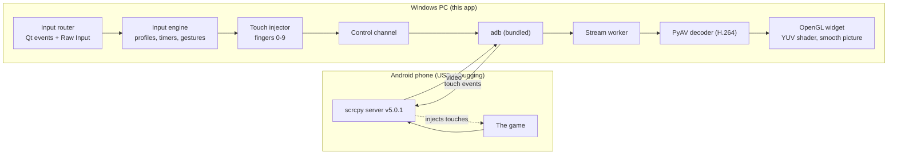

# Mobile Key One

**Play your real Android phone on a big PC screen with your keyboard and mouse, over a USB cable.**


-41cd52)


> **Developed by Santhosh** &nbsp;|&nbsp; Portfolio: **[a-santhosh-hub.github.io/in](https://a-santhosh-hub.github.io/in/)**

Mobile Key One is **not an emulator**. The game keeps running on your phone. The app mirrors the phone's screen to the PC
and turns your keys and mouse into real touches on that phone, in the style of the key-mapping tools of Android emulators
(BlueStacks, GameLoop, TC Games), but for the phone you already own.

---

## Why I built this

Mobile shooters such as PUBG Mobile and Call of Duty: Mobile are designed for a touch screen, yet many players aim and move
better with a keyboard and a mouse on a big monitor. The usual answer is an Android emulator. An emulator, however, is a
second, virtual phone: it needs a heavy install, runs the game through a translation layer, and is not the device and
account you actually play on.

I wanted the opposite: **keep the real phone, and only borrow the PC's screen, keyboard and mouse.** That also made it a
good engineering project, because it touches many hard areas at once:

- a **low-latency video pipeline** (H.264 from the phone, decoded and drawn on the GPU in real time),
- a **timing-critical input engine** that turns key presses into multi-finger touch gestures without ever leaving a finger
  stuck on the screen,
- **Windows Raw Input** for real mouse-look aiming,
- a **drag-and-drop layout editor** and a profile format that has to survive upgrades,
- and a test strategy for software that, by nature, controls a physical device.

Instead of wrapping an existing tool, I wrote my own client for the open-source
[scrcpy](https://github.com/Genymobile/scrcpy) server protocol, so I understand and control every layer.

---

## What it does

**Picture**
- Phone picture on the PC with low delay, up to the phone's full resolution and 120 fps. Quality presets from *Light* to *Max*;
  brightness, contrast, colour and sharpness controls; fullscreen.
- **Smooth picture (optional, F5):** generates an in-between picture for every two real ones with a motion-compensated GPU shader,
  so a 30 fps stream is shown as 60. It pauses itself when it cannot help. Details: [docs/SMOOTH_PICTURE.md](docs/SMOOTH_PICTURE.md).

**Keyboard and mouse to touches**
- Tap, hold, toggle, auto-repeat, double tap, swipe, drag, pinch zoom, multi-tap sequences, key combinations such as
  `Shift+W`, and one key touching several places at once.
- **WASD movement stick** with sprint, walk and auto-run keys.
- **Mouse aiming**: real mouse movement turns the camera (Raw Input, mouse confinement, endless turning), a separate
  sensitivity while scoped in, `~` / `F8` or a held key to free the mouse.
- Mouse wheel bindings (for example weapon switching).

**Smart helpers**
- **Smart pick-up** (PUBG Mobile loot list): one key opens the "Nearby" list *only if it is closed*, extra keys (for example
  `G` `H` `K`) take the 1st, 2nd, 3rd item, and the mouse wheel scrolls the open list. The app looks at the phone picture to
  know whether the list is open, so it never taps blindly.
- **Smart mode**: learns what a game's controls look like, so mouse aiming works in a match and the mouse behaves like a finger in menus.
- **Per-game profiles** that load by themselves when that game opens on the phone.

**Editor and profiles**
- Drag markers onto the game's buttons, double-click to change a key, right-click for options.
- Save / Undo / Reset restore points, ready-made templates (standard shooter, battle royale).
- A **checks panel** explains conflicts (the same key used twice, a key that is also a window shortcut, ...) in plain words.
- Profiles are plain JSON, versioned, and older files upgrade without data loss.

---

## How it works



| Layer | Folder | What it does |
|---|---|---|
| Device | `app/device` | adb wrapper, USB hot-plug tracking, foreground-app watcher |
| Stream | `app/stream` | scrcpy protocol, session set-up, worker thread, control channel |
| Video | `app/video` | decoder, YUV frame, OpenGL widget, picture look, smooth picture |
| Input | `app/input` | touch injector, input engine, Qt event router, Windows Raw Input |
| Mapping | `app/mapping` | profile model and checks, templates, layout-editor logic, smart pick-up |
| UI | `app/ui` | main window, sidebar, settings, overlay, theme |

---

## Engineering highlights

- **Own scrcpy client.** Reimplements the protocol (handshake, video stream, touch/key control messages) and pins the server to
  v5.0.1, because client and server versions must match exactly.
- **A deterministic input engine.** The engine has no Qt in it; time is injected, so the whole behaviour is replayed in tests.
  341 recorded scenarios ("golden traces") pin the exact touch sequence for every gesture. Timers carry an epoch, so stopping the
  mapping, losing window focus, rotating the phone or unplugging the cable cancels everything and lifts every finger.
- **GPU everywhere it matters.** YUV to RGB, scaling with mipmaps, sharpening and colour controls run in a fragment shader; the CPU does
  no per-pixel work. *Smooth picture* adds a coarse-to-fine motion search and a per-pixel motion-compensated blend, measured against ground truth.
- **Safety by design for a tool that touches a real device.** GUI tests run only against a simulated phone, behind guards that
  refuse real data folders and real devices. Scripts that do talk to a phone need an explicit opt-in flag, a real terminal
  and a typed confirmation.
- **Profiles that survive upgrades.** Versioned JSON, permanent ids, unknown fields preserved, backups made before any migration.
- **Honest verification.** The docs say what was checked on a simulated phone, what on real hardware, and what was not checked yet.

---

## Requirements

- Windows 10 or 11
- Python 3.11 or newer
- An Android phone with **USB debugging** turned on (Settings > Developer options) and a USB cable that carries data
- A GPU / driver with OpenGL 3.0 or newer (any normal Windows PC)

## Install and run

```bat
python -m venv .venv
.venv\Scripts\pip install -r requirements.txt
run.bat
```

`run.bat` starts `python -m app`. The `vendor` folder already contains `adb` and the scrcpy server (see
[THIRD_PARTY_NOTICES.md](THIRD_PARTY_NOTICES.md)); nothing else needs to be installed on the phone.

## Quick start

1. Plug in the phone, allow USB debugging when it asks, press **Connect**.
2. Open your game on the phone. Press **+ New** to make controls for it (or pick a template), then **Edit controls**
   and drag each marker onto the matching button of the game. The mouse-look area belongs on an empty part of the view.
3. Press **Start playing** (`F9`). `Esc` stops.

| Key | Does |
|---|---|
| `F9` | Key mapping on / off |
| `F8` or `~` | Lock / free the mouse |
| hold `Alt` | Free the mouse while held |
| `F11` | Fullscreen |
| `F5` | Smooth picture on / off |
| `F2` / `F3` / `F4` | Key markers more transparent / more visible / hide |
| `Esc` | Stop playing and release everything |

All of these can be changed in Settings > Shortcuts. Profiles are plain JSON files in
`%LOCALAPPDATA%\MobileKeyOne\profiles`.

---

## Tests

```bat
.venv\Scripts\python.exe -m pytest tests -q
```

2519 unit tests. The GUI tests in `tools/` run **without a phone**: `tools/fake_phone.py` attaches a simulated one, and every
touch is intercepted. They are isolated by code (no ADB, no scrcpy, a private data folder). Run them all with
`.venv\Scripts\python.exe tools\run_isolated.py --all` (12 suites). See [docs/TESTING.md](docs/TESTING.md).

```bat
.venv\Scripts\python.exe tools\look_gl_test.py       the GPU picture controls, measured on real pixels
.venv\Scripts\python.exe tools\smooth_gl_test.py     smooth picture, measured against ground-truth frames
.venv\Scripts\python.exe tools\gl_selftest.py        the OpenGL renderer
```

Other scripts in `tools/` talk to a real phone (`stream_test.py`, `control_test.py`, `game_*`, `pubg_*`, `cod_*`). Each refuses to
start without `--really-use-real-phone`, a terminal and a typed confirmation, and some press keys on the phone or touch a running
game: read a script first. To check a real phone step by step, follow
[docs/REAL_DEVICE_VERIFICATION.md](docs/REAL_DEVICE_VERIFICATION.md).

## Status and honest limits

- Built and tested on Windows 11 with an Android 16 phone over USB. **Windows only** (Raw Input and OpenGL).
- The basics (picture, taps, movement stick, mouse aiming, wheel) were checked on a real phone in the early stages. The newer advanced
  controls (extra modes, shared triggers, the editor's new options) are covered by simulated tests and still wait for the
  hardware checklist in [docs/REAL_DEVICE_VERIFICATION.md](docs/REAL_DEVICE_VERIFICATION.md).
- **Smart pick-up** and **Smooth picture** are verified on simulated phones and synthetic or recorded pictures only. They have
  **not** yet been judged on a real game, so timings (for example the wait for the loot list) may need tuning.
- Smooth picture adds about half a picture of delay: leave it off for aiming, use it for looking around and looting.
- It does not make a game run at more FPS. The phone decides that.

## Responsible use

- This is an **input tool**, not a cheat. It does not read or change game memory, does not modify game files, and does
  not try to hide from anti-cheat. Features that exist only to avoid detection (input randomisation, recoil
  compensation macros) are deliberately **not** included.
- Many online games forbid external input tools, and a ban is possible. The *repeat tap* mode is an auto-clicker and may
  count as cheating online. Use the app where it is allowed, and test on a spare account first. You use it at your own
  risk. More in [docs/RESEARCH.md](docs/RESEARCH.md).

## Project layout

```
app/device    adb wrapper, hot-plug tracker, foreground-app watcher
app/stream    scrcpy protocol, session, worker thread
app/video     decoder, YUV frame, OpenGL widget, picture look, smooth picture
app/input     touch injector, input engine, Qt event router, Raw Input
app/mapping   profiles (JSON), templates, layout-editor logic, smart pick-up
app/ui        main window, sidebar, settings, overlay, theme
app/scene.py  smart mode: game screen vs menu
vendor/       adb and the scrcpy server v5.0.1 (client and server versions must match exactly)
tests/        unit tests (and the golden touch traces)
tools/        GUI tests, helper and device scripts
docs/         research notes, testing guide, real-device checklist, smooth picture
```

## Reliability notes

- **Profile identity.** Every profile has a permanent `id` stored in its JSON file; the file name no longer decides which
  profile is which, so names such as `COD: BR` and `COD? BR` can no longer overwrite each other. Profile files from older
  versions get an id the first time the app starts; the originals are copied to `profiles/backup-before-ids/` first.
- **Control messages.** Touch MOVE events are coalesced (only the newest position of a finger waits); touch DOWN/UP and every
  other message are never dropped or reordered. A phone that stops answering ends the connection with a clear message
  instead of letting the queue grow.
- **Rotation / resolution change.** Every finger is lifted at the new size, running actions are cancelled, and key mapping for
  a profile made for the other orientation pauses and resumes by itself when the phone turns back.

## Roadmap

- Judge and tune Smart pick-up and Smooth picture on real game footage.
- More one-key helpers for PUBG Mobile: drop a weapon, open a loot box, hold-to-revive.
- Screenshots and a short demo video for this page.

---

## About the developer

**Developed by Santhosh.**
Portfolio: **<https://a-santhosh-hub.github.io/in/>**

Built with [Claude Code](https://claude.com/claude-code) (Anthropic's AI coding assistant) as a pair-programming helper.

## Credits and licence

Built on [scrcpy](https://github.com/Genymobile/scrcpy) (Apache-2.0) by Genymobile, Android's `adb`, Qt for Python
(PySide6), PyAV / FFmpeg and NumPy. See [THIRD_PARTY_NOTICES.md](THIRD_PARTY_NOTICES.md).

Mobile Key One is released under the **MIT License**, see [LICENSE](LICENSE). Mobile Key One is an independent project and is not
affiliated with Genymobile, Google, Tencent, Activision, Krafton or any game publisher.
